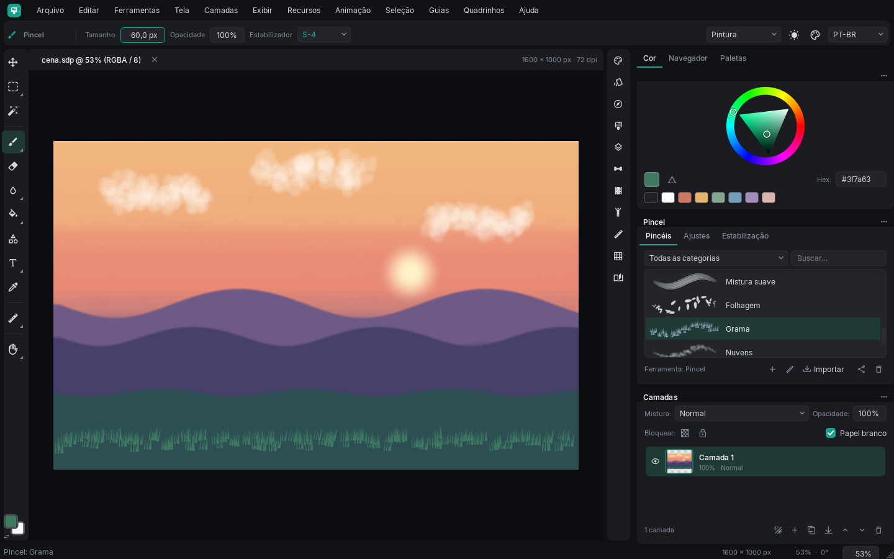
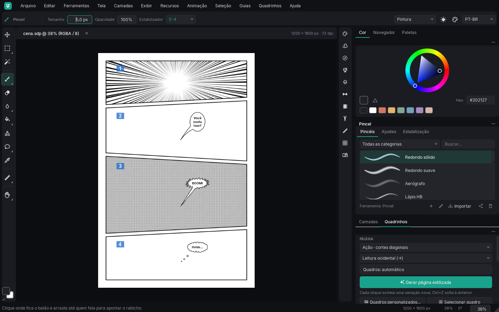
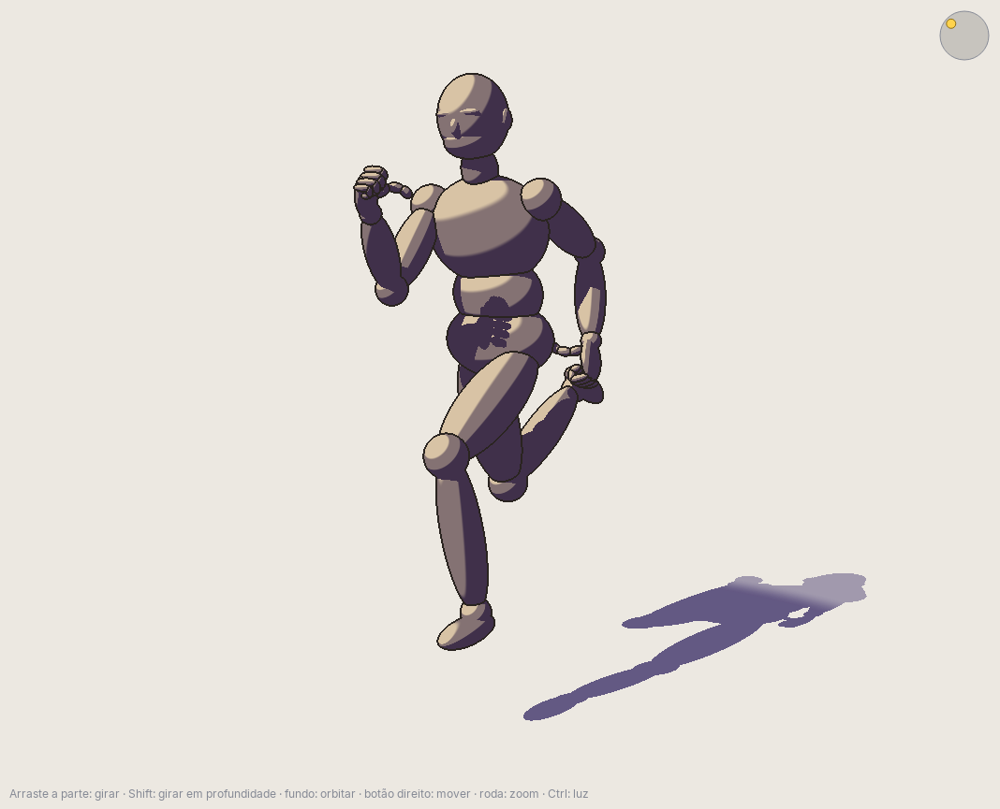
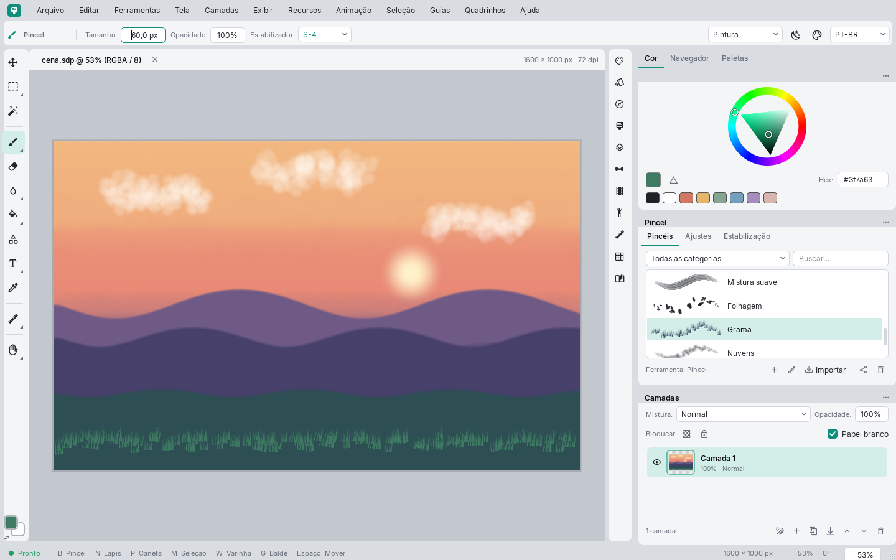

# Lumira

Programa de desenho e pintura digital para Windows, feito em Python com PyQt6.

Pensado para desenhar com mesa digitalizadora: estabilizador de traço ajustável, pincéis com
textura, ferramentas de quadrinho, animação quadro a quadro e um manequim 3D para referência de pose.



## O que tem

**Pintura.** São 41 pincéis prontos: lápis, nanquim, aquarela, carvão, cerdas, giz, spray e outros.
Os pincéis respondem à pressão da caneta e podem usar textura de papel. Também dá para criar pincéis
do zero ou importar arquivos `.abr` do Photoshop.

**Traço firme.** O estabilizador tem níveis de 1 a 15 para suavizar e de S-1 a S-7 para contornos
mais firmes. O modo *Toque leve* deixa a caneta responder bem mesmo com pouca pressão.

**Quadrinhos.** Um clique gera uma página com quadros (ação, mangá, cinematográfico…). Depois é só
acrescentar balões, onomatopeias, linhas de ação e retícula. Também gera capítulos inteiros, numera
as páginas e exporta tudo em PDF.

**Animação.** Timeline com onion skin, esqueleto com IK para posar personagens 2D, câmera, áudio e
legendas. A exportação sai em MP4, GIF ou spritesheet.

**Referência 3D.** Manequim articulado com poses prontas, luz ajustável e vários estilos de sombra
(cel, hachura, retícula…). A figura pode ser inserida direto na tela como camada. Também abre
modelos `.glb`.

**O resto.** Camadas com modos de mistura, seleções e varinha mágica, guias de perspectiva, simetria,
paletas (importa GIMP, Lospec e Adobe), temas claro e escuro personalizáveis e interface em português
ou inglês.

| Quadrinhos | Manequim 3D |
|---|---|
|  |  |

<details>
<summary>Tema claro</summary>



</details>

## Como rodar

Testado com Python 3.13.

```powershell
python -m venv venv
.\venv\Scripts\python.exe -m pip install -r requirements.txt
.\venv\Scripts\python.exe main.py
```

Depois da primeira vez, dá para abrir com dois cliques no `iniciar.bat`.

### Gerar o executável

```powershell
.\venv\Scripts\python.exe -m pip install -r requirements-build.txt
powershell -ExecutionPolicy Bypass -File .\compilar.ps1
```

O resultado é um único `dist\Lumira.exe` que roda em qualquer Windows 64 bits, sem precisar de
Python. No executável, configurações e pincéis ficam em `%LOCALAPPDATA%\Lumira`. Rodando pelo
código, eles ficam na própria pasta do projeto.

## Modelos 3D e pincéis do Photoshop

O repositório não traz modelos 3D nem pincéis `.abr`, porque esses arquivos são de outros autores.
O programa funciona normalmente sem eles. Se tiver os seus, coloque os `.glb` em `assets/3D` (eles
aparecem na lista do manequim) e importe os `.abr` pelo painel de pincéis.

## Dicas

- Para começar, use o estabilizador em **S-4** e a pressão em **Toque leve**. Se o traço atrasar
  demais, baixe o nível.
- **F11** esconde os painéis e deixa só a tela.
- Projetos salvos em `.sdp` guardam camadas, animação e guias. Para gerar imagem, use
  **Arquivo → Exportar**.
- Para compartilhar pincéis, use o botão de compartilhar no painel de pincéis. Ele copia um código de
  texto que dá para mandar por mensagem; quem recebe cola em **Importar → Colar código**.

<details>
<summary>Atalhos</summary>

| Ação | Atalho |
|---|---|
| Pincel / lápis / caneta / pixel art | B / N / P / Shift+N |
| Borracha / balde / conta-gotas | E / G / I |
| Esfumar / degradê / formas / texto | Shift+E / Shift+G / O / T |
| Seleção retangular / elíptica / laço / varinha | M / Shift+M / L / W |
| Mover pixels / mover tela / girar vista | V / H / R |
| Diminuir / aumentar pincel | [ / ] |
| Pegar cor rapidamente | Ctrl + clique |
| Mover tela | Espaço + arrastar ou botão do meio |
| Ajustar à janela / 100% | Ctrl+0 / Ctrl+1 |
| Desfazer / refazer | Ctrl+Z / Ctrl+Shift+Z ou Ctrl+Y |
| Selecionar tudo / desmarcar / inverter | Ctrl+A / Ctrl+D / Ctrl+Shift+I |
| Copiar / recortar / colar como camada | Ctrl+C / Ctrl+X / Ctrl+V |
| Nova camada / duplicar | Ctrl+Shift+N / Ctrl+J |
| Simetria / espelhar vista / tons de cinza | Shift+S / Ctrl+Alt+F / Ctrl+Alt+Y |
| Régua paralela / perspectiva | U / Shift+U |
| Réguas / grade / ajustar às guias | Ctrl+R / Ctrl+' / Ctrl+; |
| Página estilizada / balão / selecionar quadro | Ctrl+Alt+G / Shift+T / Shift+W |
| Esqueleto / manequim 3D / camada de sombra | K / Ctrl+Shift+M / Ctrl+Shift+H |
| Reproduzir / quadro anterior / próximo | Enter / , / . |
| Personalizar aparência | Ctrl+Alt+K |
| Salvar / salvar como / exportar PNG | Ctrl+S / Ctrl+Shift+S / Ctrl+Shift+E |

</details>

## Testes

```powershell
.\venv\Scripts\python.exe -m unittest discover -s tests
```

Os testes que dependem de modelos 3D ou de pincéis `.abr` são pulados quando esses arquivos não
estão na pasta `assets`.

## Licença

[GPL v3](LICENSE), a mesma do PyQt6. A fonte Inter, incluída em `assets/fonts`, é distribuída sob a
[SIL Open Font License](assets/fonts/OFL-Inter.txt).
